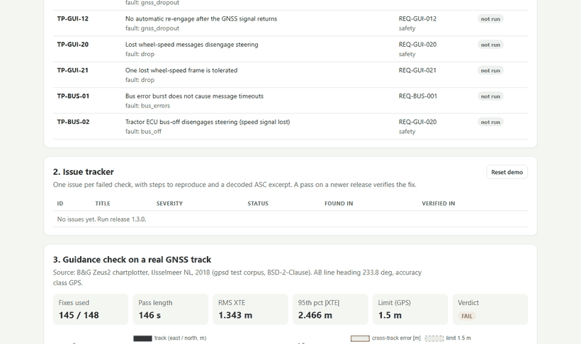
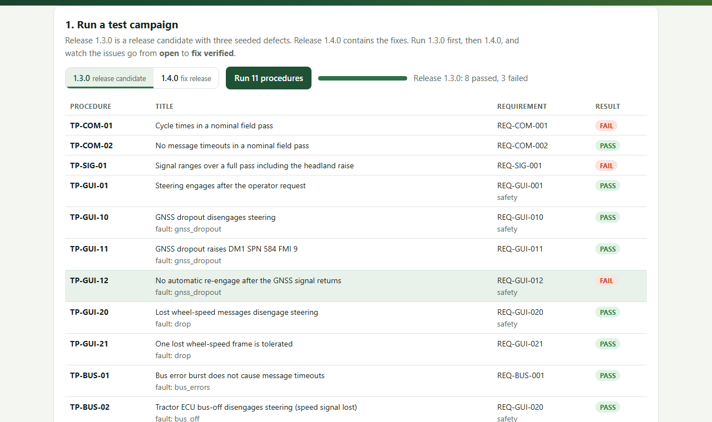
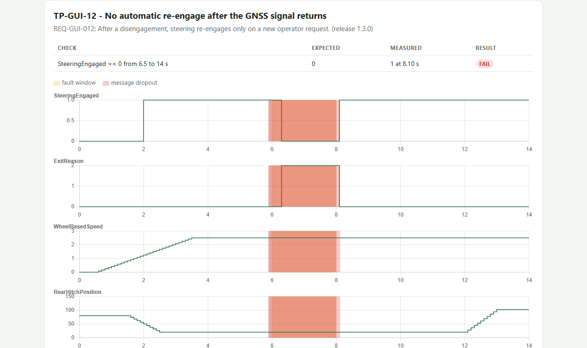
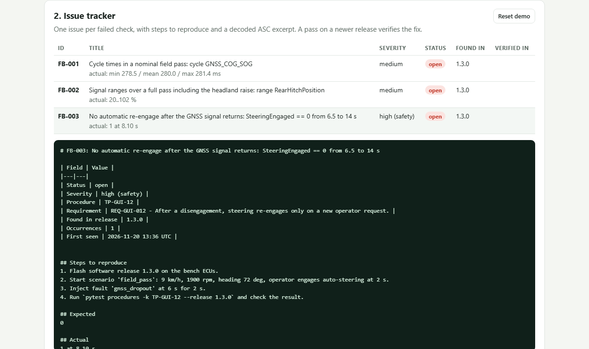
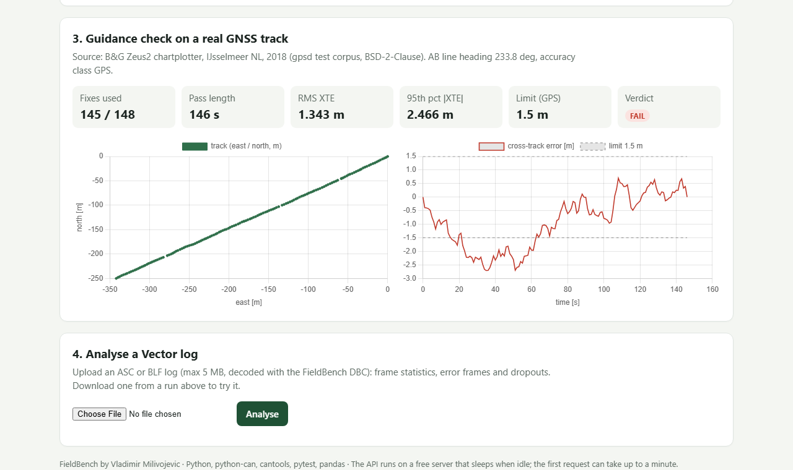
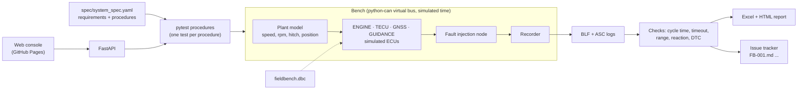
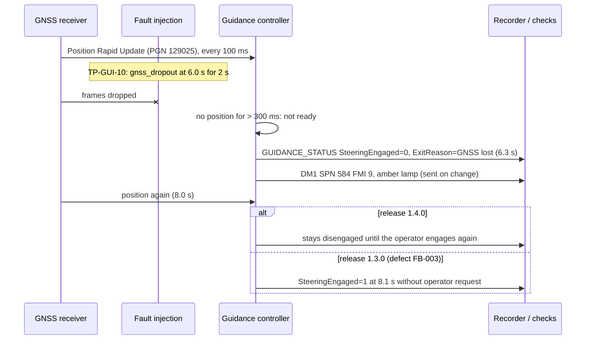
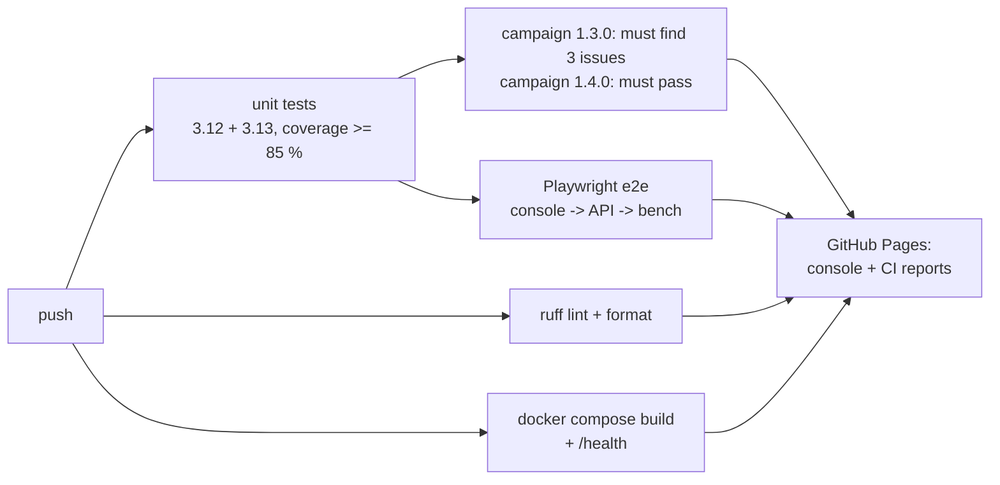

<div align="center">

# FieldBench

**CAN / ISOBUS test bench for precision-farming systems.**<br>
Simulated tractor and guidance ECUs on a virtual CAN bus, test procedures from a YAML system spec run with pytest,
fault injection, Vector ASC/BLF log analysis and a GNSS cross-track-error check.

[](https://github.com/vladimirmilivojevic-creator/fieldbench/actions/workflows/ci.yml)


### [▶ Open the live demo](https://vladimirmilivojevic-creator.github.io/fieldbench/)

[Latest CI test report](https://vladimirmilivojevic-creator.github.io/fieldbench/ci/report_1.3.0.html) ·
[API docs](https://fieldbench-api.onrender.com/docs) ·
[How it works](#how-it-works) ·
[Sample defect report](docs/sample_defect_report.md) ·
[Test plan template](docs/test_plan_template.md)



</div>

## Try it in 30 seconds

1. Open the [live demo](https://vladimirmilivojevic-creator.github.io/fieldbench/).
2. Keep release **1.3.0** selected and click **Run all procedures**. Three procedures fail and three issues open.
   The failed GNSS-dropout procedure opens with its signals: steering switches itself back on at 8.1 s.
3. Click an issue to read the defect report: steps to reproduce, expected / actual and a decoded ASC log excerpt.
4. Select **1.4.0** and run again. All 11 procedures pass and the issues change to **fix verified**.

| Release | What it is | Result |
|---|---|---|
| `1.3.0` | Release candidate with three seeded defects | 8 passed, 3 failed, 3 issues opened |
| `1.4.0` | Fix release | 11 passed, issues FB-001..003 verified |

> [!NOTE]
> The web console is a static page on GitHub Pages and is always online. The bench API runs on a free Render
> instance that sleeps when idle: the first request can take up to a minute, the page shows "Waking up..." meanwhile.
> The [CI reports](https://vladimirmilivojevic-creator.github.io/fieldbench/ci/report_1.3.0.html) work without it.

## Highlights

<table>
<tr>
<td width="33%"><b>Spec-driven tests</b><br>10 requirements and 11 procedures in <code>spec/system_spec.yaml</code>. Every procedure becomes a pytest case; a unit test fails if a requirement has no procedure.</td>
<td width="33%"><b>J1939 / ISOBUS messages</b><br>EEC1, Wheel-based Speed, Rear Hitch Status, NMEA 2000 GNSS position and COG/SOG, guidance status and DM1, all defined in a DBC and decoded with cantools.</td>
<td width="33%"><b>Fault injection</b><br>Lost messages, GNSS dropout, ECU bus-off and bus-error bursts (error frame + retransmission), injected by a node between the ECUs and the bus.</td>
</tr>
<tr>
<td><b>Issues from failures</b><br>Each failed check opens an issue with steps, expected / actual and a decoded ASC excerpt. A pass on a later release marks it "fix verified".</td>
<td><b>Root-cause tools</b><br><code>fieldbench analyze</code> reads Vector ASC / BLF, prints cycle-time statistics, flags dropouts and error frames and plots signals.</td>
<td><b>Guidance accuracy</b><br><code>fieldbench guidance</code> reads NMEA from a file or a serial GNSS receiver and computes the cross-track error against an AB line, per RTK / DGPS / GPS class.</td>
</tr>
</table>

## Screenshots

| Campaign on release 1.3.0 | Failed procedure with fault window |
|---|---|
|  |  |
| **Issue tracker and defect report** | **Guidance check on a real GNSS track** |
|  |  |

## How it works



The guidance controller is a small state machine: it engages on an operator request when GNSS and wheel speed
are fresh (less than 300 ms old) and the speed is between 0.5 and 15 m/s, and disengages with an exit reason
when any of that stops being true. A GNSS loss also raises DM1 SPN 584 FMI 9.



### The seeded defects in release 1.3.0

| Issue | Procedure | Defect | Found by |
|---|---|---|---|
| FB-001 | TP-COM-01 | GNSS COG/SOG sent every 280 ms instead of 250 ms (+/-10 %) | cycle-time check |
| FB-002 | TP-SIG-01 | Hitch sensor reads 102 % at the end stop; without a clamp the ECU sends raw `0xFF`, which J1939 reserves for "not available" | range check |
| FB-003 | TP-GUI-12 | Operator engage request stays latched, so steering re-engages by itself when GNSS returns (safety) | `holds` check after GNSS dropout |

## Tech stack

| Area | Used |
|---|---|
| CAN | python-can (virtual bus, BLF / ASC reader and writer), cantools (DBC encode / decode) |
| Protocols | J1939 PGNs 61444, 65096, 65093, 65226 (DM1); NMEA 2000 PGNs 129025, 129026; NMEA 0183 GGA / RMC |
| Tests | pytest (procedures from YAML, 83 unit tests, 99 % coverage, gate 85 %), Playwright e2e |
| Data | pandas, matplotlib, openpyxl (Excel report), Jinja2 (HTML report) |
| GNSS | pyserial (`COM5`, `/dev/ttyUSB0`, `loop://` in tests), own GGA / RMC parser with checksum |
| Console | FastAPI API on Render (Docker), static HTML + Chart.js on GitHub Pages |
| CI | GitHub Actions: lint, unit tests on 3.12 and 3.13, campaign on both releases, e2e, Docker build, Pages deploy |

## Command line

```bash
fieldbench run --release 1.3.0                 # pytest campaign -> results/report_1.3.0.html|xlsx, results/issues/
pytest procedures -k TP-GUI --release 1.4.0    # same thing, plain pytest, only guidance procedures
fieldbench simulate --fault '{"type":"gnss_dropout","at_s":6,"duration_s":2}' --out results/field
fieldbench analyze results/field.blf --plot results/field.png
fieldbench guidance --nmea samples/nmea/ijsselmeer_bg_zeus2.nmea --plot results/xte.png
fieldbench guidance --serial COM5 --baud 38400  # live GNSS receiver
```

Example output of `fieldbench analyze` on a GNSS dropout:

```
        message  frames  nominal_ms  mean_ms  max_gap_ms
           EEC1     701          20     20.0        21.6
  GNSS_POSITION     121         100    116.7      2100.5
...
dropouts (gap > 3 x cycle): 2
  GNSS_COG_SOG        5.750 s ->    8.000 s  (2250 ms)
  GNSS_POSITION       5.900 s ->    8.001 s  (2100 ms)
```

## Guidance check on a real track

The sample track `samples/nmea/ijsselmeer_bg_zeus2.nmea` is a real NMEA recording from a B&G Zeus2 chartplotter on
the IJsselmeer (NL), taken from the gpsd test corpus (BSD-2-Clause). It is a boat, not a tractor, but it is a
straight 146-second pass with plain GPS fixes. Against the AB line through its first and last fix it gives an RMS
cross-track error of 1.34 m and a 95th percentile of 2.47 m, so it **fails** the 1.5 m GPS class: the boat drifted
up to 2.7 m off the line. A second sample from a Trimble receiver covers RTK fix quality in the parser tests.

## API overview

| Method | Path | What it does |
|---|---|---|
| GET | `/health` | liveness for Render and the keep-alive job |
| GET | `/api/spec` | releases, requirements, procedures |
| POST | `/api/runs` | start a campaign `{release, procedures?}`, returns a run id (202) |
| GET | `/api/runs/{id}` | progress and per-procedure results |
| GET | `/api/runs/{id}/signals/{procedure}` | decoded signals, fault windows and dropouts for charts |
| GET | `/api/runs/{id}/report.html` · `report.xlsx` · `logs/{file}` | report and BLF / ASC downloads |
| GET / DELETE | `/api/issues` | issue tracker / reset the demo |
| GET | `/api/issues/{id}.md` | defect report as Markdown |
| GET | `/api/guidance` | XTE of the real sample track |
| POST | `/api/analyze` | upload an ASC / BLF log (max 5 MB): statistics and dropouts |

## CI



If the fix release fails on `main`, the workflow opens a GitHub issue per open defect report (deduplicated by title).

<details>
<summary><b>Run locally</b></summary>

```bash
python -m venv .venv
.venv/Scripts/activate            # Windows; on Linux/macOS: source .venv/bin/activate
pip install -e ".[dev]"
pytest --cov                      # unit tests with coverage gate
fieldbench run --release 1.3.0    # campaign, results in ./results
fieldbench serve                  # API on http://127.0.0.1:8000
cd site && python -m http.server 5500   # console on http://localhost:5500
```

With Docker: `docker compose up` (API on :8000, console on :5500) or `docker compose run campaign`.

End-to-end tests: `pip install -e ".[e2e]" && python -m playwright install chromium`, start the API and the
console as above, then `pytest e2e --browser chromium`.

</details>

## Design decisions

- **Simulated time instead of wall-clock time.** The bench advances in 5 ms steps, so a 14 s pass runs in about
  0.4 s and gives identical frames on every machine (scheduler jitter is seeded). Real hardware would only change
  the python-can interface, see [bench setup](docs/bench_setup.md).
- **One shared interface for all simulated ECUs.** The first version gave every ECU its own virtual bus; python-can
  copies each frame to every receiver, and profiling showed most of the time went there. One "simulated nodes"
  interface (like simulated nodes in CANoe) plus a separate recorder made a run about three times faster.
- **Checks run on the recorded log,** not on ECU internals, the same way a field log is analysed.
- **The spec is not the DBC.** The DBC describes the messages; the YAML spec states the requirements; the ECU
  code of a release is the thing under test. The checks never read cycle times from the ECU code, so a release
  that sends every 280 ms fails against the 250 ms requirement.
- **Bugs found while building it:** release names like `1.4.0` turned log files into `TP-GUI-10_1.4.blf`
  (`Path.with_suffix`); the BLF writer crashed because the virtual channel name was parsed as a channel number;
  pandas returned `numpy.bool_` that FastAPI could not serialise (caught by the API test); and a traceability
  table showed that REQ-GUI-011 had no procedure, which is now a unit test.

## Roadmap

- [x] DBC, simulated ECUs, fault injection, pytest procedures from YAML
- [x] ASC / BLF analysis, dropout detection, Excel / HTML report, issue tracker
- [x] NMEA from file and serial, cross-track error per accuracy class
- [x] Web console, CI with campaign + e2e, Docker
- [ ] Run the same procedures against a real ECU through a Vector or PEAK interface
- [ ] ISO 11783 transport protocol (multi-packet DM1, more than one DTC)
- [ ] CAPL version of the GNSS-dropout test for CANoe
- [ ] Record my own tractor pass with an RTK receiver as a second guidance sample

---

<div align="center">
Built by <b>Vladimir Milivojevic</b> · <a href="https://github.com/vladimirmilivojevic-creator">GitHub</a> · MIT License
</div>
